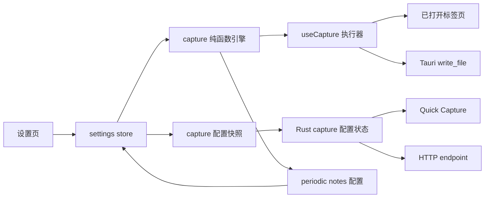

## Product Overview

阅读 Obsidian 插件 `xiaoyuanTasksCalendar` 的捕获实现和设置后，在 xiaoyuanNote 中形成一套统一、可扩展、可迁移的捕获方案。目标是让用户用一套配置管理闪念、记录、任务、日记、周报、月报、季报、年报和会议记录等捕获目标，并让命令面板、快捷键、HTTP 端点和日历入口共享同一套语义。

## Core Features

- 数据驱动的捕获配置：每个配置包含名称、目标位置、输入方式、内容格式、插入位置、模板、日期标记和打开行为。
- 内置预设与用户预设：提供九类默认预设，支持新增、复制、重命名、删除、排序、重置和拖拽。
- 捕获变量与路径别名：支持文本变量、日期时间变量、文件变量、选区和剪贴板变量，并支持周期笔记路径别名。
- 实时预览：配置编辑时显示最终捕获文本和目标路径，预览与执行共用规则。
- 安全写入：保留 dirty tab 优先、本机 HTTP、Bearer token、默认关闭和路径穿越防护。
- 多入口统一：命令面板、快速捕获小窗、HTTP 捕获、日历单元格和编辑器选区都复用同一套配置语义。
- 可迁移设置：旧 `captures` 配置自动补齐新字段，不丢失用户已有配置。

## Tech Stack Selection

沿用当前项目技术栈，不引入新框架：

- 前端：Vue 3、TypeScript、Pinia、Vite。
- UI：现有 `Ds*` 无头组件和 `styles/tokens.css` 设计令牌。
- 桌面层：Tauri 2、Rust、`tauri::command`、本地 HTTP endpoint。
- 配置持久化：Pinia 状态写入 LocalStorage；Rust 侧只接收必要快照，不重复持有完整用户配置。
- 测试：Node 原生测试运行 TS 纯函数，Rust 集成测试覆盖 HTTP 与写入链路。

## Implementation Approach

整体策略是“插件配置模型借鉴，当前项目架构落地”：把 Obsidian 插件中成熟的 `CaptureConfig`、路径别名、变量体系、插入优先级和实时预览机制迁移到 xiaoyuanNote，但底层路径和文件写入继续复用当前项目的 `periodic-notes.ts`、`useCapture.ts` 和 Rust capture 写入函数。

关键决策：

- 不建立第二套周期笔记路径配置。所有周期路径继续来自 `settings.periodic`，包括新增的 `flash`。
- 不在 Rust 侧重写前端捕获引擎。前端 Presets 保持纯函数加执行器的结构；Rust 只接收必要配置快照，用于 Quick Capture 和 HTTP endpoint。
- 保留当前写入安全规则。已打开且未保存的标签页必须由前端写入，避免磁盘覆盖用户编辑；未打开文件的写入继续走 Rust 命令并发送 own-write 事件。
- 捕获结果显式区分成功与未写入。借鉴插件的 `InsertResult`，返回是否插入、原因和目标路径，避免“执行完成但内容未写入”仍提示成功。
- 去重作为可选策略而不是默认行为。捕获默认继续追加；如需去重，可在配置中增加 `dedupeKey`，但放在第二阶段，避免破坏现有 Presets 行为。

性能与可靠性：

- 单条捕获只读取和写入一个目标文件，时间复杂度接近文件读写成本，不做全库扫描。
- 路径解析复用 `periodicTarget`，不重复格式化或遍历目录。
- 配置快照只包含 capture configs 和 endpoint 设置，体积极小。
- 模板缺失、未知变量、空输入、目标为文件夹、未打开工作区、标题不存在和写入失败都要返回可行动错误。

## Implementation Notes

- 旧 `CapturePreset` 继续作为 `CaptureConfig` 的兼容子集；`normalizeCapturePresets` 扩展为按 id 深度合并，保留用户已有配置。
- `CAPTURE_PERIODS` 改为复用 `ALL_PERIODIC_KINDS`，让 Presets 能捕获到 `flash`，与设置页的「闪念」一致。
- Quick Capture 小窗不直接访问主窗口 Pinia store；通过 Tauri 命令接收当前捕获配置快照或目标配置 id。
- HTTP endpoint 继续保持本机监听、Bearer token 和 release 默认关闭；新增 preset 字段时只扩展 JSON body，不改安全模型。
- Endpoint 的 `enabled`、`port`、`token`、`inbox_folder` 迁入 settings store，并由 `App.vue` 现有 watchEffect 推送到 Rust，解决重启后状态丢失。
- 设置搜索需要索引 `capture`、`quick`、`periodic`、`inbox`、`闪念`、`捕获` 等关键词。

## Architecture Design



## Directory Structure

```text
app/src/
├── lib/
│   ├── capture-config.ts          # [NEW] CaptureConfig 类型、默认预设、按 id 合并和旧配置迁移
│   ├── capture-variables.ts       # [NEW] VALUE、DATE、TIME、FILE、SELECTION、CLIPBOARD 等变量展开
│   ├── capture-insert.ts          # [NEW] top、bottom、afterHeading、currentLine、newLine 插入策略
│   ├── capture.ts                 # [MODIFY] 保留旧导出，改为组合上述纯函数并兼容现有调用
│   ├── periodic-notes.ts          # [MODIFY] 视需要导出 ALL_PERIODIC_KINDS 给捕获配置使用
│   └── settings-search.ts         # [MODIFY] 增加捕获和周期笔记关键词索引
├── stores/
│   └── settings.ts                # [MODIFY] captures 升级、endpoint 设置持久化、配置快照 actions
├── composables/
│   ├── useCapture.ts              # [MODIFY] 接受显式 value、targetDate、selection，返回结构化结果
│   └── useCommands.ts             # [MODIFY] 动态命令传递配置 id，必要时增加选区捕获命令
├── components/
│   ├── CapturePresetsSection.vue  # [MODIFY] 改成配置列表、复制、排序、重置和入口管理
│   ├── CaptureConfigModal.vue     # [NEW] 捕获配置编辑弹窗，包含实时预览
│   ├── CaptureConfigRow.vue       # [NEW] 单个捕获配置行组件，承载按钮和拖拽
│   ├── SettingsPanel.vue          # [MODIFY] 调整捕获设置区块顺序和说明
│   ├── QuickCapture.vue           # [MODIFY] 支持从配置快照选择目标配置
│   └── Toolbar.vue                # [MODIFY] 第二阶段增加选区捕获右键入口
app/src-tauri/src/
├── capture_endpoint.rs            # [MODIFY] 接收配置快照，扩展 HTTP body，持久化 endpoint 状态
├── quick_capture.rs               # [MODIFY] 按配置执行快速捕获
├── lib.rs                         # [MODIFY] 注册新增 Tauri 命令
└── runner.rs                      # [MODIFY] 同步注册新增 Tauri 命令
app/src-tauri/tests/
└── capture_e2e_test.rs            # [MODIFY] 增加 preset 字段、鉴权、health 和配置快照测试
app/src/lib/
├── capture-config.test.ts         # [NEW] 默认值、迁移和按 id 合并测试
├── capture-variables.test.ts      # [NEW] 变量展开和未知 token 测试
├── capture-insert.test.ts         # [NEW] 插入优先级和 InsertResult 测试
├── capture.test.ts                # [MODIFY] 保留旧 API 兼容测试
└── settings-search.test.ts        # [MODIFY] 捕获关键词命中测试
docs/
└── capture.md                     # [NEW] 捕获配置、变量、路径别名和入口说明
```

## Key Code Structures

```text
type CaptureInputMethod = 'single-line' | 'multi-line' | 'none'

interface CaptureConfig {
  id: string
  name: string
  description: string
  enabled: boolean
  target: 'file' | 'folder' | 'periodic' | 'active'
  period: PeriodKind
  path: string
  fileName: string
  format: string
  template: string
  placement: 'top' | 'bottom' | 'heading' | 'currentLine' | 'newLineAbove' | 'newLineBelow'
  heading: string
  inputMethod: CaptureInputMethod
  autoCreated: boolean
  autoDue: boolean
  appendLink: boolean
  openAfter: boolean
  dedupeKey?: string
}

interface CaptureRunOptions {
  value?: string
  targetDate?: string
  selection?: string
  clipboard?: string
  configId?: string
}

interface CaptureResult {
  inserted: boolean
  path: string
  reason?: 'missingWorkspace' | 'emptyInput' | 'missingHeading' | 'unknownVariable' | 'writeFailed'
}
```

## Design Style

捕获设置继续使用当前项目的日历设置页语言和 `Ds*` 组件体系。配置列表采用紧凑卡片行，编辑入口使用模态表单，表单按“目标、输入、格式、插入位置、完成后行为”分区。实时预览固定显示在编辑区底部，执行与预览共用同一套规则，避免用户猜测最终内容。

## Layout

- 捕获设置列表：每行显示启用状态、名称、目标摘要、复制、编辑、重置、删除和拖拽手柄。
- 编辑弹窗：分区表单，字段少而集中；复杂路径和格式字段提供说明与预览。
- 快速捕获小窗：保持极简，仅输入框、保存按钮和 Esc 取消，不增加配置负担。
- 日历入口：点击或双击已有入口保持不变，新增捕获入口只在必要时显示指示器。

## Interaction

- 新增配置默认进入编辑弹窗。
- 复制配置生成新 id 和“副本”名称，并插入当前行之后。
- 内置预设允许重置，用户自定义配置允许删除。
- 编辑格式时实时更新预览；未知变量用明确提示，不静默丢弃。
- 所有危险或不可达操作都用行内错误说明，不打断整个设置页。

## Agent Extensions

### SubAgent

- **code-explorer**
- Purpose: 复核外部插件与当前项目捕获相关调用链，确认所有受影响文件和兼容点。
- Expected outcome: 形成可执行的改动清单，避免遗漏命令注册、Tauri 双入口注册、测试和配置迁移路径。