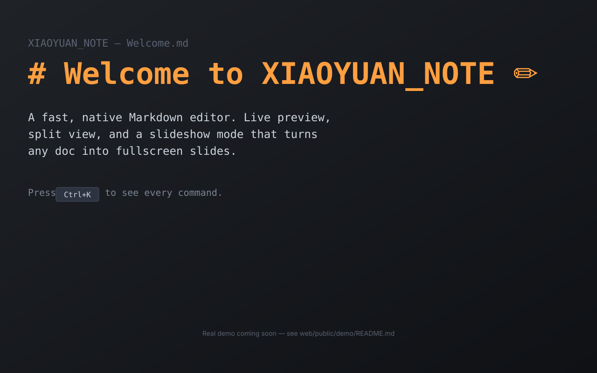

# xiaoyuanNote

> El editor donde viven los agentes.

[](https://github.com/zhitongblog/xiaoyuan-note/releases/latest)
[](LICENSE)
[](https://github.com/zhitongblog/xiaoyuan-note/releases)
[](https://github.com/zhitongblog/xiaoyuan-note/stargazers)
[](https://xiaoyuannote.app)

🌐 **[English](README.md) · [中文](README.zh.md) · [日本語](README.ja.md) · [한국어](README.ko.md) · [Deutsch](README.de.md) · [Français](README.fr.md) · [Português](README.pt.md) · [Italiano](README.it.md) · [Polski](README.pl.md) · [Nederlands](README.nl.md) · [Türkçe](README.tr.md) · [Svenska](README.sv.md) · [Українська](README.uk.md)**

[**Descargar v4.0**](https://github.com/zhitongblog/xiaoyuan-note/releases/latest) · [**Post de lanzamiento**](https://xiaoyuannote.app/blog/v4-0-0-agent-native-author/) · [**Sitio web**](https://xiaoyuannote.app) · [**Seguridad**](https://xiaoyuannote.app/security)



> ### 🤖 Desarrollado y mantenido por Claude
>
> xiaoyuanNote lo escribe, prueba y publica casi por completo **Claude Code**, el agente de
> programación de Anthropic, bajo un mantenedor humano que marca el rumbo y decide qué se
> publica. **Las issues y los pull requests también los clasifica y responde Claude**: las
> respuestas que recibes aquí las escribe una IA, no las teclea una persona.
>
> Lo contamos por dos razones. Debes saber a qué le confías tus notas: el código es MIT y
> es todo público, léelo. Y cuando una respuesta sea rotunda pero errónea —ocurre— dilo en
> el hilo. Esa corrección es el mecanismo.

Tus notas viven en una carpeta. **xiaoyuanNote es el editor encima — con una superficie de agente de primera clase dentro del editor, y el endpoint MCP que Claude Code / Cursor pueden manejar desde fuera.** Los mismos archivos `.md`. Chatea con tu vault. Programa recipes que se ejecutan cuando no estás al teclado. Entrega el mismo vault a cualquier cliente MCP.

Construido sobre Tauri 2 + Vue 3 + CodeMirror 6. Universal macOS dmg ~32 MB. Gratis, MIT, sin suscripción, sin servidores alojados por xiaoyuan-note. Tus notas, claves AI, índice de embeddings e historial git permanecen todos en tu máquina.

## Tres mitades de un producto

**El editor.** Edición en vivo WYSIWYG (estilo Typora), pestañas + paneles divididos, KaTeX + Mermaid, pegar imágenes a `_assets/`, modo diapositivas (`⌘⌥P`), modo Vim, Hunspell + revisión CJK, búsqueda semántica (`⌘⇧F`), wikilinks + backlinks, exportar con Pandoc. Codificaciones CJK (GBK / Big5 / Shift-JIS) auto-detectadas.

**El endpoint.** Un binario `xiaoyuan-note-mcp` empaquetado expone el mismo vault a cualquier cliente MCP — 16 herramientas (15 listadas por defecto), incluidas las herramientas AutoGit / sync / share propias de xiaoyuanNote (`autogit_log`, `autogit_diff`, `autogit_rollback`, `sync_status`, `share_url`) que ningún otro servidor markdown tiene. v4.0 añade federación `--workspace path1 --workspace path2` — una sesión MCP, muchos vaults. Más un CLI `xiaoyuanNote agent <prompt>` que entrega a Claude Code / Codex CLI con MCP precableado.

**La superficie de agente (v4.0).** Panel Agent a la derecha: chat-with-vault transmitido, citaciones `[[wikilink]]`, tarjetas de llamadas a herramienta inline, botones **Insertar** / **Copiar** dejan la respuesta en la nota activa. Más **recipes** declarativos como YAML en `<workspace>/.xiaoyuan-note/agents/*.yml` — disparadores `cron` / `on-save` / `on-commit` / `on-tag-add` / manual. **Cada escritura de agente aterriza en su propia rama AutoGit que aceptas o rechazas** antes de que toque `main`; write-cap por defecto 5; rehúsa iniciarse cuando el árbol de trabajo está sucio; `trace.jsonl` reproducible por ejecución con la herramienta MCP `read_agent_trace`.

| Funcionalidad | |
|---|---|
| **Panel Agent** *(v4.0)* | Chat-with-vault transmitido al mismo nivel que Outline / Backlinks / Tags / History. Tarjetas de llamadas a herramienta se expanden inline; respuesta Insert / Copy al editor activo; historial de ejecución persiste como markdown plano bajo `.xiaoyuan-note/agent-runs/`. |
| **Recipes programados** *(v4.0)* | Trabajos YAML en tu vault. Sandbox de rama AutoGit + UI accept/reject antes del merge. Write-cap por ejecución (por defecto 5, techo 50). Cookbook de 11 recipes en el árbol. |
| **Trace reproducible** *(v4.0)* | `trace.jsonl` por paso (`prompt` / `model_call` / `tool_call` / `tool_result` / `git_commit`). Replay-from-step rebobina y vuelve a ejecutar. |
| **Federación de workspace** *(v4.0)* | `xiaoyuan-note-mcp --workspace path1 --workspace path2`. Una sesión Claude Desktop, muchos vaults. UI de perfiles MCP en Ajustes → Integraciones. |
| **Ollama de primera clase** *(v4.0)* | Auto-detección en `localhost:11434`. Tres presets de modelo (`qwen2.5:1.5b/7b/14b`). Alias de recipe `provider: local` para bucles autónomos de coste cero en la nube. |
| **Reescritura IA, BYOK** | 14 providers — OpenAI · Claude · Gemini · DeepSeek · Qwen · GLM · Kimi · Doubao · SiliconFlow · OpenRouter · Mistral · Groq · xAI · Ollama. Llamadas directas al proveedor. Claves en el llavero del SO. |
| **Sync respaldado por GitHub** | Empuja tu vault a un repo privado de GitHub en cada guardado. E2EE opcional (Argon2id + XChaCha20-Poly1305). GitLab / Gitea / cualquier URL git HTTPS también funciona. |
| **AutoGit por nota** | Cada `⌘S` es un commit en un `.git` local dentro del workspace. libgit2 incluido, no se necesita git del sistema. Nunca se hace auto-push. |
| **Servidor MCP empaquetado** | `xiaoyuan-note-mcp` viene en la instalación. 16 herramientas (12 de lectura + 4 de escritura; 15 listadas por defecto). Solo stdio, sin puerto de red. Solo lectura por defecto; `--allow-write` opt-in. |
| **API REST** *(v4.0)* | Solo localhost, auth por token. Misma superficie que MCP para clientes que aún no hablan MCP — Alfred / Raycast / n8n / tus propios scripts. |
| **Medidor de coste BYOK** *(v4.0)* | Contador acumulado de tokens gastados por provider, opt-in. Ajustes → Integraciones. |
| **Modo carpeta cloud** | Si tu vault vive en `~/Library/Mobile Documents/...` o `~/Dropbox/...`, xiaoyuanNote lo detecta y añade restauración de sesión entre dispositivos encima — el SO ya hace la sync de archivos. |
| **Compartir público de solo lectura** | Paleta de comandos → copiar enlace `xiaoyuannote.app/share/?repo=...&path=...`. Renderiza cualquier archivo en tu repo público de GitHub, no necesitas cuenta xiaoyuanNote para verlo. |

## Uso

Después de instalar xiaoyuanNote en macOS / Linux:

**1. Chatea con tu vault.** Abre el panel Agent a la derecha (⌘⇧P → "View: Toggle Agent Panel" si está oculto). Multi-turno transmitido contra tus notas; tarjetas de llamadas a herramienta muestran cada lectura/escritura inline. ¿Respuesta demasiado larga? **Insertar** la deja en la posición del cursor en la nota activa (reemplaza selección); **Copiar** al portapapeles.

**2. Programa un recipe.** Ajustes → Recipes → Explorar cookbook. 11 starters listos: revisión semanal, resumen diario, extracción TODO, pase de traducción, limpieza de citaciones, agente de revisión CJK, detector de link rot, normalizador de frontmatter, outline-a-blog, pase de refactor, triaje semanal de tags. Instala uno, edita el prompt, ejecútalo.

**3. Maneja el mismo vault desde otro cliente LLM.** One-shot:

```bash
# Imprime el snippet de config MCP para tu cliente IA.
xiaoyuanNote mcp-config
```

```json
{
  "mcpServers": {
    "xiaoyuanNote": {
      "command": "/Applications/xiaoyuannote.app/Contents/MacOS/xiaoyuan-note-mcp",
      "args": ["--workspace", "/Users/me/Documents/xiaoyuanNote"]
    }
  }
}
```

Pega en Claude Desktop / Cursor / etc. Para federación multi-vault, repite `--workspace`:

```json
"args": [
  "--workspace", "/Users/me/Documents/xiaoyuanNote",
  "--workspace", "/Users/me/Documents/work-notes"
]
```

**4. O entrega un prompt directamente a claude / codex CLI:**

```bash
xiaoyuanNote agent "reescribe esta semana de notas diarias como una revisión semanal y commitéala"
```

Path-traversal protegido. Sin puerto de red. El LLM solo ve a lo que apuntes el workspace.

## Instalación

Última release: [**v4.0.0**](https://github.com/zhitongblog/xiaoyuan-note/releases/latest).

### macOS — universal dmg (Apple Silicon + Intel, firmado + notarizado)

```bash
brew install --cask zhitongblog/xiaoyuan-note/xiaoyuanNote
```

O descargar el dmg directamente:

```
https://github.com/zhitongblog/xiaoyuan-note/releases/latest/download/XIAOYUAN_NOTE_4.0.0_universal.dmg
```

O instalación shell de una línea:

```bash
curl -fsSL https://xiaoyuannote.app/install.sh | bash
```

### Windows — x64

- [`XIAOYUAN_NOTE_4.0.0_x64_en-US.msi`](https://github.com/zhitongblog/xiaoyuan-note/releases/latest/download/XIAOYUAN_NOTE_4.0.0_x64_en-US.msi)
- [`XIAOYUAN_NOTE_4.0.0_x64-setup.exe`](https://github.com/zhitongblog/xiaoyuan-note/releases/latest/download/XIAOYUAN_NOTE_4.0.0_x64-setup.exe) (NSIS)
- [`XIAOYUAN_NOTE_4.0.0_x64-portable.zip`](https://github.com/zhitongblog/xiaoyuan-note/releases/latest/download/XIAOYUAN_NOTE_4.0.0_x64-portable.zip) — sin instalador

```powershell
irm https://xiaoyuannote.app/install.ps1 | iex
```

```powershell
winget install xiaoyuanNote
```

### Linux — x86_64 + aarch64

- `.AppImage` (universal), `.deb` (Debian/Ubuntu), `.rpm` (Fedora/RHEL) — ambas arquitecturas desde [la página de releases](https://github.com/zhitongblog/xiaoyuan-note/releases/latest).
- Usuarios Arch: [`xiaoyuan-note-bin`](https://aur.archlinux.org/packages/xiaoyuan-note-bin) en AUR.

### iPad

[App Store](https://apps.apple.com/app/xiaoyuan-note/id6762498874) — mismo motor, UI nativa de iPad.

## Privacidad y seguridad

Puramente del lado del cliente. Tus archivos `.md` permanecen en la carpeta que elegiste. Las claves API viven en el llavero del SO (macOS Keychain / Windows Credential Manager / Linux libsecret), nunca en `localStorage` o un archivo de config. Las solicitudes IA van directo de tu máquina al provider que elegiste — sin relé xiaoyuan-note. Embeddings RAG y el repo AutoGit son solo locales. El servidor MCP habla stdio, nunca abre puerto de red. Todo el código es MIT y auditable.

**Salvaguardas de agente (v4.0).** Cada ejecución de recipe inicia en su propia rama AutoGit — tu `main` permanece intacto hasta que hagas clic en Aceptar en el diff. Write-cap por ejecución (por defecto 5, techo duro 50) previene bucles descontrolados. El runner de recipe rehúsa iniciar cuando el árbol de trabajo está sucio (ningún commit de agente arrastrará tu WIP). Las guardas de path-traversal rechazan segmentos `..` y rutas absolutas por adelantado en cada endpoint Tauri / MCP / REST que acepta una ruta del usuario.

La sync E2EE usa Argon2id (parámetros por defecto RFC9106) → XChaCha20-Poly1305 con nonces deterministas y ruta-como-AAD. El texto plano permanece en tus dispositivos; el remoto solo ve cifrado. El parseo fallido de `sync.json` es fail-closed — rehúsa empujar en lugar de degradarse a texto plano (un fix de auditoría v3.0.x).

Writeup completo: <https://xiaoyuannote.app/security>.

## Compilar desde fuente

Requisitos: Rust (stable), Node 18+, pnpm.

```bash
git clone https://github.com/zhitongblog/xiaoyuan-note.git
cd xiaoyuan-note/app
pnpm install
pnpm tauri dev      # dev con hot reload
pnpm tauri build    # artefactos release → src-tauri/target/release/bundle/
```

Linux necesita además `libdbus-1-dev` para el backend del llavero.

El servidor MCP es un crate separado en `mcp-server/`; el harness MCP dev usado para tests end-to-end vive en `dev-mcp/`. Punto de entrada de tests end-to-end: `scripts/v4-self-test.sh` (ejecutar con `--with-release --with-ollama --with-ui` para cobertura completa).

## Contribuir

Issues y PRs bienvenidos — [abre uno](https://github.com/zhitongblog/xiaoyuan-note/issues). Para un sentido de la dirección, ver [`docs/roadmap.md`](docs/roadmap.md). El log de build v4.0 está en [xiaoyuannote.app/blog/v4-0-0-how-we-built-it/](https://xiaoyuannote.app/blog/v4-0-0-how-we-built-it/) — empieza ahí si quieres entender los principios de ingeniería antes de enviar un PR.

## Contacto

Un mantenedor, dos puertas de entrada. Asíncrono en [GitHub Discussions](https://github.com/zhitongblog/xiaoyuan-note/discussions). Chat en tiempo real:

- **Telegram (internacional):** [@xiaoyuanNoteAPP](https://t.me/xiaoyuanNoteAPP) — anuncios de release + chat
- **WeChat (中文):** escanea para añadirme — nota "xiaoyuanNote"

## Licencia y créditos

[MIT](LICENSE) © 2026 xiangdong li. xiaoyuanNote se apoya en Tauri 2, Vue 3, CodeMirror 6, markdown-it, KaTeX, Mermaid, libgit2, Pandoc, Hunspell, `keyring-rs` y `rmcp`. Patrocina en [GitHub Sponsors](https://github.com/sponsors/zhitongblog) o vía [xiaoyuannote.app/#sponsor](https://xiaoyuannote.app/#sponsor).
