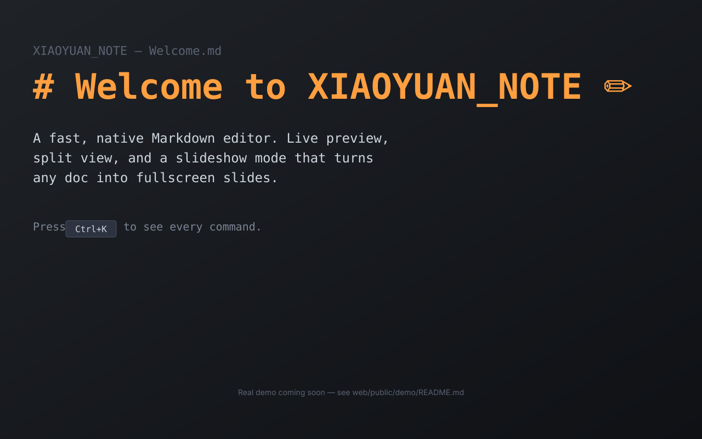

# xiaoyuanNote

> Edytor, w którym mieszkają agenty.

[](https://github.com/zhitongblog/xiaoyuan-note/releases/latest)
[](LICENSE)
[](https://github.com/zhitongblog/xiaoyuan-note/releases)
[](https://github.com/zhitongblog/xiaoyuan-note/stargazers)
[](https://xiaoyuannote.app)

🌐 **[English](README.md) · [中文](README.zh.md) · [日本語](README.ja.md) · [한국어](README.ko.md) · [Deutsch](README.de.md) · [Français](README.fr.md) · [Español](README.es.md) · [Português](README.pt.md) · [Italiano](README.it.md) · [Nederlands](README.nl.md) · [Türkçe](README.tr.md) · [Svenska](README.sv.md) · [Українська](README.uk.md)**

[**Pobierz v4.0**](https://github.com/zhitongblog/xiaoyuan-note/releases/latest) · [**Post premierowy**](https://xiaoyuannote.app/blog/v4-0-0-agent-native-author/) · [**Strona**](https://xiaoyuannote.app) · [**Bezpieczeństwo**](https://xiaoyuannote.app/security)



> ### 🤖 Tworzone i utrzymywane przez Claude
>
> xiaoyuanNote jest pisane, testowane i wydawane niemal w całości przez **Claude Code**, agenta
> programistycznego Anthropic, pod okiem ludzkiego opiekuna, który wyznacza kierunek i
> decyduje, co trafia do wydania. **Zgłoszenia i pull requesty również obsługuje i
> odpowiada na nie Claude** — odpowiedzi, które tu otrzymujesz, pisze SI, a nie człowiek.
>
> Mówimy o tym z dwóch powodów. Powinieneś wiedzieć, czemu powierzasz swoje notatki: kod
> jest na licencji MIT i w całości jawny, przeczytaj go. A gdy odpowiedź jest pewna siebie
> i błędna — to się zdarza — napisz o tym w wątku. Ta korekta jest całym mechanizmem.

Twoje notatki żyją w folderze. **xiaoyuanNote to edytor nad nim — z pierwszorzędnym interfejsem agenta wewnątrz edytora oraz endpointem MCP, który Claude Code / Cursor mogą sterować z zewnątrz.** Te same pliki `.md`. Rozmawiaj ze swoim vaultem. Planuj recipes, które działają, gdy nie ma cię przy klawiaturze. Przekaż ten sam vault dowolnemu klientowi MCP.

Zbudowane na Tauri 2 + Vue 3 + CodeMirror 6. Universal macOS dmg ~32 MB. Darmowe, MIT, bez subskrypcji, bez serwerów hostowanych przez xiaoyuan-note. Twoje notatki, klucze AI, indeks embeddings i historia Git pozostają na twojej maszynie.

## Trzy połówki jednego produktu

**Edytor.** Edycja WYSIWYG w stylu live (Typora), zakładki + podzielone panele, KaTeX + Mermaid, wstawianie obrazów do `_assets/`, tryb pokazu slajdów (`⌘⌥P`), tryb Vim, korekta Hunspell + CJK, wyszukiwanie semantyczne (`⌘⇧F`), wikilinki + backlinki, eksport Pandoc. Kodowania CJK (GBK / Big5 / Shift-JIS) wykrywane automatycznie.

**Endpoint.** Dołączony plik binarny `xiaoyuan-note-mcp` udostępnia ten sam vault każdemu klientowi MCP — 16 narzędzi (domyślnie 15), w tym narzędzia AutoGit / sync / share specyficzne dla xiaoyuanNote (`autogit_log`, `autogit_diff`, `autogit_rollback`, `sync_status`, `share_url`), których nie ma żaden inny serwer Markdown. v4.0 dodaje federację `--workspace path1 --workspace path2` — jedna sesja MCP, wiele vaultów. Plus CLI `xiaoyuanNote agent <prompt>`, które przekazuje do Claude Code / Codex CLI z prekonfigurowanym MCP.

**Powierzchnia agenta (v4.0).** Prawy panel agenta: strumieniowy chat-with-vault, cytaty `[[wikilink]]`, karty wywołań narzędzi inline, przyciski **Wstaw** / **Kopiuj** umieszczają odpowiedź w aktywnej notatce. Plus deklaratywne **recipes** jako YAML w `<workspace>/.xiaoyuan-note/agents/*.yml` — wyzwalacze `cron` / `on-save` / `on-commit` / `on-tag-add` / ręczne. **Każdy zapis agenta trafia na własną gałąź AutoGit, którą akceptujesz lub odrzucasz** zanim dotknie `main`; domyślny limit zapisu 5; odmawia uruchomienia, gdy drzewo robocze jest brudne; powtarzalny `trace.jsonl` na każde uruchomienie z narzędziem MCP `read_agent_trace`.

| Funkcja | |
|---|---|
| **Panel agenta** *(v4.0)* | Strumieniowy chat-with-vault na równi z Outline / Backlinks / Tags / History. Karty wywołań narzędzi rozwijają się inline; odpowiedź Wstaw / Kopiuj do aktywnego edytora; historia uruchomień zachowywana jako czysty Markdown w `.xiaoyuan-note/agent-runs/`. |
| **Zaplanowane recipes** *(v4.0)* | Zadania YAML w twoim vaulcie. Sandbox gałęzi AutoGit + UI accept/reject przed merge. Limit zapisu na uruchomienie (domyślnie 5, maksimum 50). Książka kucharska 11 recipes w drzewie. |
| **Powtarzalny ślad** *(v4.0)* | `trace.jsonl` per krok (`prompt` / `model_call` / `tool_call` / `tool_result` / `git_commit`). Replay-from-step cofa i uruchamia ponownie. |
| **Federacja workspace'ów** *(v4.0)* | `xiaoyuan-note-mcp --workspace path1 --workspace path2`. Jedna sesja Claude Desktop, wiele vaultów. UI profili MCP w Ustawienia → Integracje. |
| **Ollama pierwszej klasy** *(v4.0)* | Auto-wykrywanie pod `localhost:11434`. Trzy ustawienia modelu (`qwen2.5:1.5b/7b/14b`). Alias `provider: local` w recipes dla autonomicznych pętli bez chmury. |
| **Przepisywanie AI, BYOK** | 14 dostawców — OpenAI · Claude · Gemini · DeepSeek · Qwen · GLM · Kimi · Doubao · SiliconFlow · OpenRouter · Mistral · Groq · xAI · Ollama. Bezpośrednie wywołania do dostawcy. Klucze w pęku kluczy systemu. |
| **Sync wspierany przez GitHub** | Push vaultu do prywatnego repo GitHub przy każdym zapisie. Opcjonalne E2EE (Argon2id + XChaCha20-Poly1305). GitLab / Gitea / dowolny URL HTTPS git również działa. |
| **AutoGit per notatkę** | Każde `⌘S` to commit w lokalnym `.git` w workspace. libgit2 dołączone, system git nie jest wymagany. Nigdy automatycznie nie pushuje. |
| **Serwer MCP w pakiecie** | `xiaoyuan-note-mcp` jest zawarty w instalacji. 16 narzędzi (12 do odczytu + 4 do zapisu; domyślnie 15). Tylko stdio, żaden port sieciowy. Domyślnie tylko do odczytu; opt-in `--allow-write`. |
| **API REST** *(v4.0)* | Tylko localhost, autoryzacja tokenem. Ta sama powierzchnia co MCP dla klientów, którzy jeszcze nie mówią MCP — Alfred / Raycast / n8n / własne skrypty. |
| **Licznik kosztów BYOK** *(v4.0)* | Bieżący licznik tokenów per dostawca, opt-in. Ustawienia → Integracje. |
| **Tryb folderu w chmurze** | Jeśli twój vault leży w `~/Library/Mobile Documents/...` lub `~/Dropbox/...`, xiaoyuanNote wykryje to i doda przywracanie sesji między urządzeniami — system już synchronizuje pliki. |
| **Publiczne udostępnianie tylko do odczytu** | Paleta poleceń → skopiuj link `xiaoyuannote.app/share/?repo=...&path=...`. Renderuje dowolny plik z twojego publicznego repo GitHub, bez konta xiaoyuanNote do oglądania. |

## Użycie

Po zainstalowaniu xiaoyuanNote na macOS / Linux:

**1. Rozmawiaj ze swoim vaultem.** Otwórz prawy panel agenta (⌘⇧P → "View: Toggle Agent Panel" jeśli jest ukryty). Strumieniowy multi-turn na twoich notatkach; karty wywołań narzędzi pokazują każdy odczyt/zapis inline. Odpowiedź zbyt długa? **Wstaw** umieści ją w aktywnej notatce w pozycji kursora (zastępuje zaznaczenie); **Kopiuj** do schowka.

**2. Zaplanuj recipe.** Ustawienia → Recipes → przeglądaj książkę kucharską. 11 starterów gotowych: cotygodniowy przegląd, codzienne podsumowanie, ekstrakcja TODO, przebieg tłumaczeń, czyszczenie cytatów, agent korekty CJK, detektor martwych linków, normalizator frontmatter, outline-to-blog, refactor pass, cotygodniowa triage tagów. Zainstaluj jeden, edytuj prompt, uruchom.

**3. Steruj tym samym vaultem z innego klienta LLM.** Jednorazowe:

```bash
# Wypisz fragment konfiguracji MCP dla twojego klienta AI.
xiaoyuanNote mcp-config
```

```json
{
  "mcpServers": {
    "xiaoyuanNote": {
      "command": "/Applications/xiaoyuannote.app/Contents/MacOS/xiaoyuan-note-mcp",
      "args": ["--workspace", "/Users/me/Documents/xiaoyuanNote"]
    }
  }
}
```

Wklej do Claude Desktop / Cursor / itp. Dla federacji multi-vault, powtórz `--workspace`:

```json
"args": [
  "--workspace", "/Users/me/Documents/xiaoyuanNote",
  "--workspace", "/Users/me/Documents/work-notes"
]
```

**4. Lub przekaż prompt bezpośrednio do CLI claude / codex:**

```bash
xiaoyuanNote agent "przepisz tygodniowe notatki dzienne na cotygodniowy przegląd i zacommituj go"
```

Path traversal zabezpieczony. Żaden port sieciowy. LLM widzi tylko to, na co skierujesz workspace.

## Instalacja

Najnowsza wersja: [**v4.0.0**](https://github.com/zhitongblog/xiaoyuan-note/releases/latest).

### macOS — Universal dmg (Apple Silicon + Intel, podpisany + notarialny)

```bash
brew install --cask zhitongblog/xiaoyuan-note/xiaoyuanNote
```

Lub pobierz dmg bezpośrednio:

```
https://github.com/zhitongblog/xiaoyuan-note/releases/latest/download/XIAOYUAN_NOTE_4.0.0_universal.dmg
```

Lub instalacja jednoliniowa shell:

```bash
curl -fsSL https://xiaoyuannote.app/install.sh | bash
```

### Windows — x64

- [`XIAOYUAN_NOTE_4.0.0_x64_en-US.msi`](https://github.com/zhitongblog/xiaoyuan-note/releases/latest/download/XIAOYUAN_NOTE_4.0.0_x64_en-US.msi)
- [`XIAOYUAN_NOTE_4.0.0_x64-setup.exe`](https://github.com/zhitongblog/xiaoyuan-note/releases/latest/download/XIAOYUAN_NOTE_4.0.0_x64-setup.exe) (NSIS)
- [`XIAOYUAN_NOTE_4.0.0_x64-portable.zip`](https://github.com/zhitongblog/xiaoyuan-note/releases/latest/download/XIAOYUAN_NOTE_4.0.0_x64-portable.zip) — bez instalatora

```powershell
irm https://xiaoyuannote.app/install.ps1 | iex
```

```powershell
winget install xiaoyuanNote
```

### Linux — x86_64 + aarch64

- `.AppImage` (uniwersalny), `.deb` (Debian/Ubuntu), `.rpm` (Fedora/RHEL) — obie architektury ze [strony Releases](https://github.com/zhitongblog/xiaoyuan-note/releases/latest).
- Użytkownicy Arch: [`xiaoyuan-note-bin`](https://aur.archlinux.org/packages/xiaoyuan-note-bin) na AUR.

### iPad

[App Store](https://apps.apple.com/app/xiaoyuan-note/id6762498874) — ten sam silnik, natywne UI iPada.

## Prywatność i bezpieczeństwo

Czysto po stronie klienta. Twoje pliki `.md` zostają w folderze, który wybrałeś. Klucze API żyją w pęku kluczy systemu (macOS Keychain / Windows Credential Manager / Linux libsecret), nigdy w `localStorage` ani pliku konfiguracyjnym. Żądania AI idą bezpośrednio z twojej maszyny do wybranego dostawcy — żadnego relayu xiaoyuan-note. Embeddingi RAG i repo AutoGit są tylko lokalne. Serwer MCP mówi przez stdio, nigdy nie otwiera portu sieciowego. Cała baza kodu jest MIT i audytowalna.

**Bariery bezpieczeństwa agenta (v4.0).** Każde uruchomienie recipe startuje na własnej gałęzi AutoGit — twój `main` pozostaje nietknięty, dopóki nie klikniesz Akceptuj na diffie. Limit zapisu na uruchomienie (domyślnie 5, twardy maksimum 50) zapobiega niekontrolowanym pętlom. Runner recipe odmawia uruchomienia, gdy drzewo robocze jest brudne (żaden commit agenta nie pochłonie twojego WIP). Strażnicy path traversal odrzucają segmenty `..` i ścieżki absolutne z góry w każdym endpoincie Tauri/MCP/REST, który przyjmuje ścieżkę dostarczoną przez użytkownika.

E2EE sync używa Argon2id (parametry domyślne RFC9106) → XChaCha20-Poly1305 z deterministycznymi nonce'ami i ścieżką jako AAD. Plaintext zostaje na twoich urządzeniach; remote widzi tylko ciphertext. Nieudane parsowanie `sync.json` jest fail-closed — odmawia push zamiast degradować do plaintext (poprawka audytu v3.0.x).

Pełny opis: <https://xiaoyuannote.app/security>.

## Budowanie ze źródeł

Wymagania: Rust (stable), Node 18+, pnpm.

```bash
git clone https://github.com/zhitongblog/xiaoyuan-note.git
cd xiaoyuan-note/app
pnpm install
pnpm tauri dev      # dev z hot reload
pnpm tauri build    # artefakty release → src-tauri/target/release/bundle/
```

Linux dodatkowo wymaga `libdbus-1-dev` dla backendu pęku kluczy.

Serwer MCP to oddzielny crate pod `mcp-server/`; harness MCP dev dla testów end-to-end żyje pod `dev-mcp/`. Punkt wejścia testu end-to-end: `scripts/v4-self-test.sh` (uruchom z `--with-release --with-ollama --with-ui` dla pełnego pokrycia).

## Wkład

Issues i PR mile widziane — [otwórz jeden](https://github.com/zhitongblog/xiaoyuan-note/issues). Aby poczuć kierunek, zobacz [`docs/roadmap.md`](docs/roadmap.md). Log buildu v4.0 jest pod [xiaoyuannote.app/blog/v4-0-0-how-we-built-it/](https://xiaoyuannote.app/blog/v4-0-0-how-we-built-it/) — zacznij tam, jeśli chcesz zrozumieć zasady inżynieryjne przed wysłaniem PR.

## Kontakt

Jeden maintainer, dwoje drzwi wejściowych. Asynchronicznie na [GitHub Discussions](https://github.com/zhitongblog/xiaoyuan-note/discussions). Czat w czasie rzeczywistym:

- **Telegram (międzynarodowy):** [@xiaoyuanNoteAPP](https://t.me/xiaoyuanNoteAPP) — ogłoszenia release + czat
- **WeChat (中文):** Zeskanuj, aby mnie dodać — notatka "xiaoyuanNote"

## Licencja i podziękowania

[MIT](LICENSE) © 2026 xiangdong li. xiaoyuanNote stoi na Tauri 2, Vue 3, CodeMirror 6, markdown-it, KaTeX, Mermaid, libgit2, Pandoc, Hunspell, `keyring-rs` i `rmcp`. Sponsorzy na [GitHub Sponsors](https://github.com/sponsors/zhitongblog) lub przez [xiaoyuannote.app/#sponsor](https://xiaoyuannote.app/#sponsor).
