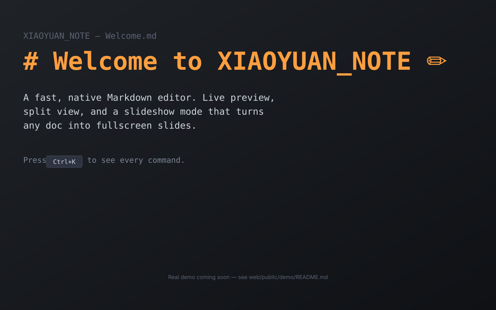

# xiaoyuanNote

> Редактор, у якому живуть агенти.

[](https://github.com/zhitongblog/xiaoyuan-note/releases/latest)
[](LICENSE)
[](https://github.com/zhitongblog/xiaoyuan-note/releases)
[](https://github.com/zhitongblog/xiaoyuan-note/stargazers)
[](https://xiaoyuannote.app)

🌐 **[English](README.md) · [中文](README.zh.md) · [日本語](README.ja.md) · [한국어](README.ko.md) · [Deutsch](README.de.md) · [Français](README.fr.md) · [Español](README.es.md) · [Português](README.pt.md) · [Italiano](README.it.md) · [Polski](README.pl.md) · [Nederlands](README.nl.md) · [Türkçe](README.tr.md) · [Svenska](README.sv.md)**

[**Завантажити v4.0**](https://github.com/zhitongblog/xiaoyuan-note/releases/latest) · [**Допис до релізу**](https://xiaoyuannote.app/blog/v4-0-0-agent-native-author/) · [**Сайт**](https://xiaoyuannote.app) · [**Безпека**](https://xiaoyuannote.app/security)



> ### 🤖 Розробляється й підтримується Claude
>
> xiaoyuanNote майже повністю пише, тестує та випускає **Claude Code**, програмувальний агент
> Anthropic, під керівництвом людини-мейнтейнера, яка задає напрям і вирішує, що виходить.
> **Issue та pull request також розбирає й коментує Claude** — відповіді, які ви тут
> отримуєте, написані ШІ, а не набрані людиною.
>
> Кажемо це з двох причин. Ви маєте знати, чому довіряєте свої нотатки: код під ліцензією
> MIT і повністю відкритий, читайте його. І коли відповідь упевнена, але хибна — таке
> буває — напишіть про це в обговоренні. Саме ця поправка і є механізмом.

Ваші нотатки живуть у теці. **xiaoyuanNote — це редактор поверх неї, з першокласним агентським інтерфейсом усередині редактора та MCP-точкою входу, якою Claude Code / Cursor можуть керувати ззовні.** Ті самі `.md`-файли. Спілкуйтеся зі своїм сховищем у чаті. Плануйте recipes, що виконуються, коли вас немає за клавіатурою. Передавайте те саме сховище будь-якому MCP-клієнту.

Побудовано на Tauri 2 + Vue 3 + CodeMirror 6. Універсальний macOS dmg ~32 МБ. Безкоштовно, MIT, без підписок, без серверів, що хостить xiaoyuan-note. Ваші нотатки, AI-ключі, індекс embeddings та історія Git — усе залишається на вашій машині.

## Три половини одного продукту

**Редактор.** WYSIWYG-редагування наживо (стиль Typora), вкладки + розділені панелі, KaTeX + Mermaid, вставка зображень у `_assets/`, режим слайд-шоу (`⌘⌥P`), Vim-режим, Hunspell + перевірка орфографії CJK, семантичний пошук (`⌘⇧F`), wikilinks + зворотні посилання, експорт через Pandoc. Кодування CJK (GBK / Big5 / Shift-JIS) визначаються автоматично.

**Точка входу.** Поставлений у комплекті бінарник `xiaoyuan-note-mcp` відкриває те саме сховище будь-якому MCP-клієнту — 16 інструментів (типово 15), у тому числі власні інструменти xiaoyuanNote AutoGit / sync / share (`autogit_log`, `autogit_diff`, `autogit_rollback`, `sync_status`, `share_url`), яких немає в жодному іншому Markdown-сервері. v4.0 додає федерацію `--workspace path1 --workspace path2` — одна MCP-сесія, багато сховищ. Плюс CLI `xiaoyuanNote agent <prompt>`, який передає Claude Code / Codex CLI із заздалегідь підключеним MCP.

**Агентський інтерфейс (v4.0).** Панель агента праворуч: чат зі сховищем у режимі стрімінгу, цитати `[[wikilink]]`, картки викликів інструментів inline, кнопки **Вставити** / **Копіювати** скидають відповідь у активну нотатку. Плюс декларативні **recipes** як YAML у `<workspace>/.xiaoyuan-note/agents/*.yml` — тригери `cron` / `on-save` / `on-commit` / `on-tag-add` / ручні. **Кожна записувальна дія агента потрапляє у власну гілку AutoGit, яку ви приймаєте або відхиляєте**, перш ніж вона торкнеться `main`; типовий write-cap 5; відмовляється стартувати, якщо робоче дерево брудне; повторюваний `trace.jsonl` на запуск з MCP-інструментом `read_agent_trace`.

| Функція | |
|---|---|
| **Панель агента** *(v4.0)* | Чат зі сховищем у режимі стрімінгу нарівні з Outline / Backlinks / Tags / History. Картки викликів інструментів розгортаються inline; відповідь Вставити / Копіювати до активного редактора; журнал запусків зберігається як чистий Markdown у `.xiaoyuan-note/agent-runs/`. |
| **Заплановані recipes** *(v4.0)* | YAML-завдання у вашому сховищі. Пісочниця гілки AutoGit + UI accept/reject перед мерджем. Write-cap на запуск (за замовчуванням 5, максимум 50). Кулінарна книга з 11 recipes у дереві. |
| **Повторюваний trace** *(v4.0)* | `trace.jsonl` на крок (`prompt` / `model_call` / `tool_call` / `tool_result` / `git_commit`). Replay-from-step перемотує і запускає знову. |
| **Федерація робочих просторів** *(v4.0)* | `xiaoyuan-note-mcp --workspace path1 --workspace path2`. Одна сесія Claude Desktop, багато сховищ. UI MCP-профілів у Налаштування → Інтеграції. |
| **Ollama першокласно** *(v4.0)* | Авто-визначення на `localhost:11434`. Три пресети моделей (`qwen2.5:1.5b/7b/14b`). Recipe-alias `provider: local` для автономних циклів без хмари. |
| **AI-переписування, BYOK** | 14 провайдерів — OpenAI · Claude · Gemini · DeepSeek · Qwen · GLM · Kimi · Doubao · SiliconFlow · OpenRouter · Mistral · Groq · xAI · Ollama. Прямі виклики до постачальників. Ключі в OS-keychain. |
| **Синхронізація через GitHub** | Push сховища до приватного репозиторію GitHub при кожному збереженні. Опціональне E2EE (Argon2id + XChaCha20-Poly1305). GitLab / Gitea / будь-який HTTPS git URL також працює. |
| **AutoGit на нотатку** | Кожний `⌘S` — це коміт у локальний `.git` у робочому просторі. libgit2 у комплекті, системний git не потрібен. Ніколи не пушиться автоматично. |
| **MCP-сервер у комплекті** | `xiaoyuan-note-mcp` входить у поставку. 16 інструментів (12 читання + 4 запису; типово 15). Лише stdio, без мережевого порту. Лише для читання за замовчуванням; opt-in `--allow-write`. |
| **REST API** *(v4.0)* | Лише localhost, авторизація за токеном. Та сама поверхня, що й MCP, для клієнтів, які ще не говорять MCP — Alfred / Raycast / n8n / власні скрипти. |
| **Лічильник вартості BYOK** *(v4.0)* | Поточний лічильник використання токенів на провайдера, opt-in. Налаштування → Інтеграції. |
| **Режим хмарної теки** | Якщо ваше сховище в `~/Library/Mobile Documents/...` або `~/Dropbox/...`, xiaoyuanNote це визначає й додає відновлення сесії між пристроями — синхронізацію файлів уже виконує OS. |
| **Публічне обмеження лише для читання** | Палітра команд → скопіюйте посилання `xiaoyuannote.app/share/?repo=...&path=...`. Рендерить будь-який файл у вашому публічному GitHub-репо, перегляд не потребує облікового запису xiaoyuan-note. |

## Використання

Після встановлення xiaoyuanNote на macOS / Linux:

**1. Спілкуйтеся зі сховищем у чаті.** Відкрийте панель агента праворуч (⌘⇧P → "View: Toggle Agent Panel", якщо приховано). Стрімований мульти-діалог по ваших нотатках; картки викликів інструментів показують кожне читання/запис inline. Відповідь занадто довга? **Вставити** скидає її у активну нотатку на позицію курсора (замінює виділення); **Копіювати** до буфера обміну.

**2. Заплануйте recipe.** Налаштування → Recipes → перегляньте кулінарну книгу. Готові 11 стартових: тижневий огляд, щоденний підсумок, витяг TODO, прохід перекладу, чищення цитат, агент перевірки орфографії CJK, детектор link rot, нормалізатор frontmatter, outline-у-блог, прохід рефакторингу, щотижневий триаж тегів. Встановіть один, відредагуйте промпт, запустіть.

**3. Керуйте тим самим сховищем з іншого LLM-клієнта.** В один рух:

```bash
# Вивести фрагмент конфігурації MCP для вашого AI-клієнта.
xiaoyuanNote mcp-config
```

```json
{
  "mcpServers": {
    "xiaoyuanNote": {
      "command": "/Applications/xiaoyuannote.app/Contents/MacOS/xiaoyuan-note-mcp",
      "args": ["--workspace", "/Users/me/Documents/xiaoyuanNote"]
    }
  }
}
```

Вставте у Claude Desktop / Cursor / тощо. Для федерації кількох сховищ повторіть `--workspace`:

```json
"args": [
  "--workspace", "/Users/me/Documents/xiaoyuanNote",
  "--workspace", "/Users/me/Documents/work-notes"
]
```

**4. Або передайте промпт безпосередньо до claude / codex CLI:**

```bash
xiaoyuanNote agent "перепиши щоденні нотатки цього тижня в тижневий огляд і закоміть його"
```

Захищено від path traversal. Без мережевого порту. LLM бачить лише те, на що ви спрямували робочий простір.

## Встановлення

Останній реліз: [**v4.0.0**](https://github.com/zhitongblog/xiaoyuan-note/releases/latest).

### macOS — універсальний dmg (Apple Silicon + Intel, підписаний + нотаризований)

```bash
brew install --cask zhitongblog/xiaoyuan-note/xiaoyuanNote
```

Або завантажте dmg напряму:

```
https://github.com/zhitongblog/xiaoyuan-note/releases/latest/download/XIAOYUAN_NOTE_4.0.0_universal.dmg
```

Або встановлення shell-командою в один рядок:

```bash
curl -fsSL https://xiaoyuannote.app/install.sh | bash
```

### Windows — x64

- [`XIAOYUAN_NOTE_4.0.0_x64_en-US.msi`](https://github.com/zhitongblog/xiaoyuan-note/releases/latest/download/XIAOYUAN_NOTE_4.0.0_x64_en-US.msi)
- [`XIAOYUAN_NOTE_4.0.0_x64-setup.exe`](https://github.com/zhitongblog/xiaoyuan-note/releases/latest/download/XIAOYUAN_NOTE_4.0.0_x64-setup.exe) (NSIS)
- [`XIAOYUAN_NOTE_4.0.0_x64-portable.zip`](https://github.com/zhitongblog/xiaoyuan-note/releases/latest/download/XIAOYUAN_NOTE_4.0.0_x64-portable.zip) — без інсталятора

```powershell
irm https://xiaoyuannote.app/install.ps1 | iex
```

```powershell
winget install xiaoyuanNote
```

### Linux — x86_64 + aarch64

- `.AppImage` (універсальний), `.deb` (Debian/Ubuntu), `.rpm` (Fedora/RHEL) — обидві архітектури зі [сторінки релізів](https://github.com/zhitongblog/xiaoyuan-note/releases/latest).
- Користувачі Arch: [`xiaoyuan-note-bin`](https://aur.archlinux.org/packages/xiaoyuan-note-bin) в AUR.

### iPad

[App Store](https://apps.apple.com/app/xiaoyuan-note/id6762498874) — той самий двигун, нативний UI iPad.

## Приватність і безпека

Чисто клієнтська сторона. Ваші `.md`-файли залишаються в обраній вами теці. API-ключі живуть в OS-keychain (macOS Keychain / Windows Credential Manager / Linux libsecret), ніколи в `localStorage` або файлі конфігурації. AI-запити йдуть з вашої машини напряму до обраного провайдера — без релею xiaoyuan-note. Embeddings RAG та репозиторій AutoGit — лише локальні. MCP-сервер говорить через stdio, ніколи не відкриває мережевий порт. Уся кодова база MIT і піддається аудиту.

**Запобіжники безпеки агентів (v4.0).** Кожен запуск recipe стартує на власній гілці AutoGit — ваш `main` залишається недоторканим, поки ви не натиснете Прийняти на diff. Write-cap на запуск (за замовчуванням 5, жорсткий максимум 50) запобігає циклам, що пішли врозніс. Recipe-runner відмовляється стартувати, якщо робоче дерево брудне (жоден агентський коміт не змете ваш WIP). Захист від path traversal заздалегідь відхиляє сегменти `..` та абсолютні шляхи в кожній точці входу Tauri / MCP / REST, яка приймає шлях, наданий користувачем.

E2EE-синхронізація використовує Argon2id (стандартні параметри RFC9106) → XChaCha20-Poly1305 з детермінованими nonce та шляхом як AAD. Відкритий текст залишається на ваших пристроях; remote бачить лише шифротекст. Невдалий парсинг `sync.json` — fail-closed: відмовляє в push, замість деградації до відкритого тексту (виправлення з аудиту v3.0.x).

Повний опис: <https://xiaoyuannote.app/security>.

## Збірка з джерел

Передумови: Rust (stable), Node 18+, pnpm.

```bash
git clone https://github.com/zhitongblog/xiaoyuan-note.git
cd xiaoyuan-note/app
pnpm install
pnpm tauri dev      # dev з hot reload
pnpm tauri build    # релізні артефакти → src-tauri/target/release/bundle/
```

Linux також потребує `libdbus-1-dev` для keychain-бекенду.

MCP-сервер — окремий crate в `mcp-server/`; dev-MCP-harness для end-to-end-тестів живе в `dev-mcp/`. Точка входу для end-to-end-тестів: `scripts/v4-self-test.sh` (запустіть з `--with-release --with-ollama --with-ui` для повного покриття).

## Внесок

Issues та PR вітаються — [відкрийте один](https://github.com/zhitongblog/xiaoyuan-note/issues). Щоб відчути напрям, дивіться [`docs/roadmap.md`](docs/roadmap.md). Журнал збірки v4.0 — на [xiaoyuannote.app/blog/v4-0-0-how-we-built-it/](https://xiaoyuannote.app/blog/v4-0-0-how-we-built-it/) — починайте звідти, якщо хочете зрозуміти інженерні принципи перед надсиланням PR.

## Контакти

Один підтримувач, двоє вхідних дверей. Асинхронно — [GitHub Discussions](https://github.com/zhitongblog/xiaoyuan-note/discussions). Чат у реальному часі:

- **Telegram (міжнародний):** [@xiaoyuanNoteAPP](https://t.me/xiaoyuanNoteAPP) — анонси релізів + чат
- **WeChat (中文):** скануйте, щоб додати мене — у нотатці "xiaoyuanNote"

## Ліцензія та подяки

[MIT](LICENSE) © 2026 xiangdong li. xiaoyuanNote стоїть на Tauri 2, Vue 3, CodeMirror 6, markdown-it, KaTeX, Mermaid, libgit2, Pandoc, Hunspell, `keyring-rs` та `rmcp`. Спонсорство на [GitHub Sponsors](https://github.com/sponsors/zhitongblog) або через [xiaoyuannote.app/#sponsor](https://xiaoyuannote.app/#sponsor).
